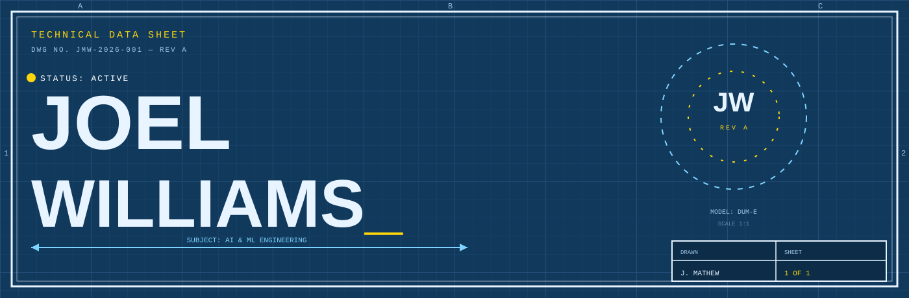
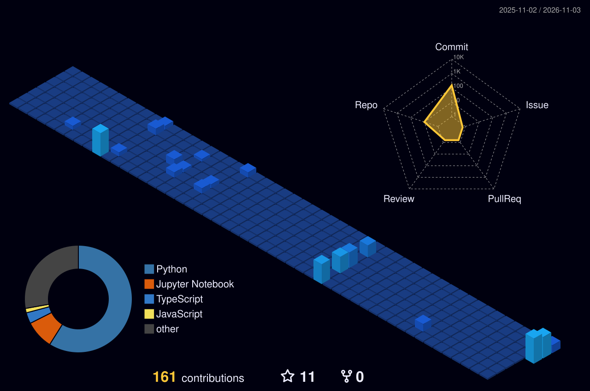

<!--
  VARIANT C ??? "BLUEPRINT / SHEET SPEC-1"
  Technical-drawing identity. Independent branch. Do not merge without review.
-->

  

  <b>SUBJECT:&nbsp; AI &amp; ML ENGINEER ??? BUILDING DUM-E &amp; GENETIC NEURAL NETWORKS</b> 
  DWG NO. JMW-2026-001&nbsp;&nbsp;??&nbsp;&nbsp;REV A&nbsp;&nbsp;??&nbsp;&nbsp;SCALE 1:1&nbsp;&nbsp;??&nbsp;&nbsp;STATUS: ACTIVE

  

### TECH-SPEC SHEET 01 ??? SUBJECT PROFILE

- **EDUCATION** ??? B.Tech Artificial Intelligence &amp; Data Science ??? SJCET, Palai
- **EXPERIENCE** ??? Machine Learning Intern ??? Cognifyz ?? PaceLab, Kozhikode
- **QUALIFICATION** ??? NASA Space Apps 2025 ??? **Global Nominee** ?? 2?? Hackathon Finalist
- **PLATFORM** ??? Windows ?? Arch Linux ?? VS Code / Cursor ?? Git
- **OFF-DUTY** ??? Royal Enfield Himalayan 450 ?? high-contrast cinematic photography
- **MISSION** ??? build intelligent systems that leave the lab and start winning

  

### TECH-SPEC SHEET 02 ??? EQUIPMENT LIST

|  |  |
|:--|:--|
| **LANG** ??? Python ?? C ?? Java ?? SQL | **DATA** ??? NumPy ?? Pandas ?? Matplotlib |
| **ML** ??? PyTorch ?? TensorFlow ?? Scikit-learn | **WEB** ??? React ?? HTML ?? CSS ?? JavaScript |
| **GENAI** ??? LangChain ?? Ollama ?? Hugging Face | **STORE** ??? MySQL ?? Firebase ?? Neon |

**TOOLS** ??? Git ?? GitHub ?? VS Code ?? Cursor ?? Jupyter

  

### TECH-SPEC SHEET 03 ??? TEST PROCEDURE

**OP-01 / DUM-E** ??? Voice-first Python desktop automation. PyAutoGUI + TTS.
 RESULT: BUILDING

**OP-02 / GENETIC NEURAL NETWORKS** ??? neuroevolution live in Pygame.
 RESULT: TRAINING

**OP-03 / NASA SPACE APPS 2025** ??? deadline engineering, finished first.
 RESULT: GLOBAL NOMINEE

**OP-04 / ML PIPELINES** ??? raw CSV ??? Jupyter ??? custom recommendation systems.
 RESULT: SHIPPING

**OP-05 / FULL-STACK FLUTTER** ??? opinionated UI on real business logic.
 RESULT: BUILDING

  

### TECH-SPEC SHEET 04 ??? FIELD TEST DATA

  

  <picture>
    <source media="(prefers-color-scheme: dark)" srcset="https://raw.githubusercontent.com/Joel-Williams-Mathew/Joel-Williams-Mathew/output/stats-dark.svg"/>
    <source media="(prefers-color-scheme: light)" srcset="https://raw.githubusercontent.com/Joel-Williams-Mathew/Joel-Williams-Mathew/output/stats-light.svg"/>
    
  </picture>
  <picture>
    <source media="(prefers-color-scheme: dark)" srcset="https://raw.githubusercontent.com/Joel-Williams-Mathew/Joel-Williams-Mathew/output/top-langs-dark.svg"/>
    <source media="(prefers-color-scheme: light)" srcset="https://raw.githubusercontent.com/Joel-Williams-Mathew/Joel-Williams-Mathew/output/top-langs-light.svg"/>
    
  </picture>

  <picture>
    <source media="(prefers-color-scheme: dark)" srcset="https://streak-stats.demolab.com?user=Joel-Williams-Mathew&amp;hide_border=true&amp;background=10395C&amp;ring=7FD4FF&amp;fire=FFD60A&amp;currStreakLabel=FFD60A&amp;currStreakNum=E8F4FF&amp;sideLabels=9CC4E4&amp;sideNums=E8F4FF&amp;dates=7A9CC0"/>
    <source media="(prefers-color-scheme: light)" srcset="https://streak-stats.demolab.com?user=Joel-Williams-Mathew&amp;hide_border=true&amp;background=10395C&amp;ring=7FD4FF&amp;fire=FFD60A&amp;currStreakLabel=FFD60A&amp;currStreakNum=E8F4FF&amp;sideLabels=9CC4E4&amp;sideNums=E8F4FF&amp;dates=7A9CC0"/>
    
  </picture>

  <picture>
    <source media="(prefers-color-scheme: dark)" srcset="https://raw.githubusercontent.com/Joel-Williams-Mathew/Joel-Williams-Mathew/output/github-contribution-grid-snake-dark.svg"/>
    <source media="(prefers-color-scheme: light)" srcset="https://raw.githubusercontent.com/Joel-Williams-Mathew/Joel-Williams-Mathew/output/github-contribution-grid-snake.svg"/>
    
  </picture>

  

### TECH-SPEC SHEET 05 ??? APPROVED FOR RELEASE

|  |  |
|:--|:--|
| **GIT** | [github.com/Joel-Williams-Mathew](https://github.com/Joel-Williams-Mathew) |
| **IN** | [linkedin.com/in/joel-williams-97b375272](https://www.linkedin.com/in/joel-williams-97b375272/) |
| **IG** | [instagram.com/jomu.willy](https://www.instagram.com/jomu.willy/) |
| **X** | [x.com/joelw2200](https://x.com/joelw2200) |
| **MAIL** | [joelw2200@gmail.com](mailto:joelw2200@gmail.com) |

  

<b>APPROVED ??? J. MATHEW ??? 2026</b> NO TOLERANCES UNLESS SPECIFIED

