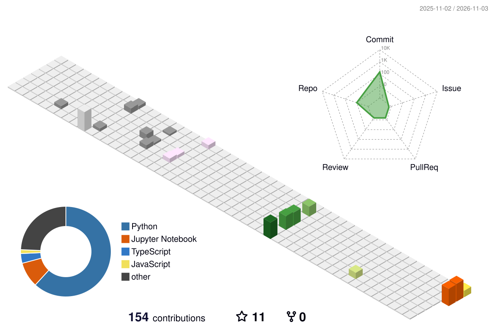

<!-- Joel Williams Mathew — profile readme (wide lockup system) -->

  <picture>
    <source media="(prefers-color-scheme: light)" srcset="./assets/hero-wide.svg">
    
  </picture>

  
  
  
  

  

## PROFILE

<table>
<tr>
<td width="34%" valign="top">

**Joel Williams Mathew**

AI &amp; Data Science engineer
building systems that leave
the lab.

</td>
<td width="66%" valign="top">

B.Tech **Artificial Intelligence &amp; Data Science** at SJCET, Palai. ML Intern at **Cognifyz** and **PaceLab, Kozhikode**. Two-time hackathon finalist and **NASA Space Apps 2025 Global Nominee**.

I work across the full path from raw data to shipped interface: Python and PyTorch for modelling, Jupyter for the analysis that changes my mind, Flutter and React for the surfaces people actually touch. Right now I am building **DUM-E**, a voice-first desktop automation system, and training **genetic neural networks** inside Pygame.

> Build it, break it, ship it — then make it cinematic.

</td>
</tr>
</table>

## NOW

<table>
<tr>
<td width="34%" valign="top">

**Shipping**

</td>
<td width="66%" valign="top">

`IN DEV` **DUM-E** — voice-first desktop automation with PyAutoGUI and text-to-speech  
`TRAINING` **Genetic Neural Networks** — neuroevolution running live inside Pygame  
`NOMINEE` **NASA Space Apps 2025** — deadline engineering, finished first  
`SHIPPING` **ML Pipelines** — raw CSV to Jupyter to recommendation logic  
`BUILDING` **Flutter Full-Stack** — interface on top of real business logic

</td>
</tr>
</table>

## STACK

<table>
<tr>
<td width="34%" valign="top">

**Languages**

</td>
<td width="66%" valign="top">

Python · C · Java · SQL

</td>
</tr>
<tr>
<td valign="top">

**Machine Learning**

</td>
<td valign="top">

PyTorch · TensorFlow · Scikit-learn · OpenCV

</td>
</tr>
<tr>
<td valign="top">

**Generative AI**

</td>
<td valign="top">

LangChain · Ollama · Hugging Face

</td>
</tr>
<tr>
<td valign="top">

**Data**

</td>
<td valign="top">

NumPy · Pandas · Matplotlib · Jupyter

</td>
</tr>
<tr>
<td valign="top">

**Interface**

</td>
<td valign="top">

Flutter · React · HTML · CSS · JavaScript

</td>
</tr>
<tr>
<td valign="top">

**Storage &amp; Tools**

</td>
<td valign="top">

MySQL · Firebase · Neon · Git · GitHub · VS Code · Cursor · Arch Linux

</td>
</tr>
</table>

## RECORD

  <picture>
    <source media="(prefers-color-scheme: dark)" srcset="https://raw.githubusercontent.com/Joel-Williams-Mathew/Joel-Williams-Mathew/output/stats-dark.svg">
    <source media="(prefers-color-scheme: light)" srcset="https://raw.githubusercontent.com/Joel-Williams-Mathew/Joel-Williams-Mathew/output/stats-light.svg">
    
  </picture>
  <picture>
    <source media="(prefers-color-scheme: dark)" srcset="https://raw.githubusercontent.com/Joel-Williams-Mathew/Joel-Williams-Mathew/output/top-langs-dark.svg">
    <source media="(prefers-color-scheme: light)" srcset="https://raw.githubusercontent.com/Joel-Williams-Mathew/Joel-Williams-Mathew/output/top-langs-light.svg">
    
  </picture>

  

  <picture>
    <source media="(prefers-color-scheme: dark)" srcset="https://raw.githubusercontent.com/Joel-Williams-Mathew/Joel-Williams-Mathew/output/github-contribution-grid-snake-dark.svg">
    <source media="(prefers-color-scheme: light)" srcset="https://raw.githubusercontent.com/Joel-Williams-Mathew/Joel-Williams-Mathew/output/github-contribution-grid-snake.svg">
    
  </picture>

  

## CONTACT

<table>
<tr>
<td width="34%" valign="top">

**Open to internships, collaborations and honest engineering conversations.**

</td>
<td width="66%" valign="top">

[github.com/Joel-Williams-Mathew](https://github.com/Joel-Williams-Mathew)  
[linkedin.com/in/joel-williams-97b375272](https://www.linkedin.com/in/joel-williams-97b375272/)  
[instagram.com/jomu.willy](https://www.instagram.com/jomu.willy/)  
[x.com/joelw2200](https://x.com/joelw2200)  
[joelw2200@gmail.com](mailto:joelw2200@gmail.com)

</td>
</tr>
</table>
