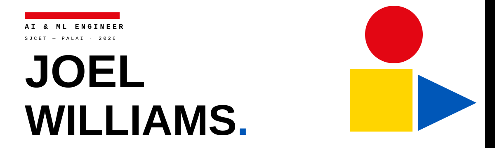

<!--
  DESIGN VARIANT B ??? "BAUHAUS" ?? swiss modernism
  Independent identity branch. Do not merge over main design without review.
-->

  

  <b>SHAPE FIRST. THEN SOLVE.</b> 
  AI &amp; ML ENGINEER ??? SJCET, PALAI

  

### ??? WHO

I build systems that leave the abstract and start winning.

- B.Tech Artificial Intelligence &amp; Data Science ??? **SJCET, Palai**
- ML Intern ??? **Cognifyz** ?? Machine Learning Intern ??? **PaceLab, Kozhikode**
- **NASA Space Apps 2025 ??? Global Nominee** ?? 2?? Hackathon Finalist
- Now: **DUM-E**, voice-first desktop automation ?? **Genetic Neural Networks** in Pygame
- Windows ?? Arch Linux ?? VS Code / Cursor
- Off-grid: Royal Enfield Himalayan 450 ?? cinematic photography

  

### ??? PRACTICE

|  |  |
|:--|:--|
| **LANG** Python ?? C ?? Java ?? SQL | **DATA** NumPy ?? Pandas ?? Matplotlib |
| **ML** PyTorch ?? TensorFlow ?? Scikit-learn | **WEB** React ?? HTML ?? CSS ?? JavaScript |
| **GENAI** LangChain ?? Ollama ?? Hugging Face | **DATA STORE** MySQL ?? Firebase ?? Neon |

  <b>TOOLS</b> Git ?? GitHub ?? VS Code ?? Cursor ?? Jupyter

  

### ??? WORK

**01 / DUM-E.** Voice-first Python desktop automation. PyAutoGUI + TTS.
 STATUS ??? BUILDING

**02 / GENETIC NEURAL NETWORKS.** Neuroevolution live inside Pygame. Evolution is the curriculum.
 STATUS ??? TRAINING

**03 / NASA SPACE APPS 2025.** Deadline-driven engineering, finished first, discussed for weeks.
 STATUS ??? GLOBAL NOMINEE

**04 / ML PIPELINES.** CSV ??? Jupyter ??? custom recommendation logic.
 STATUS ??? SHIPPING

**05 / FULL-STACK FLUTTER.** Opinionated front-ends on real business logic.
 STATUS ??? BUILDING

  

### ??? INDEX

  

  <picture>
    <source media="(prefers-color-scheme: dark)" srcset="https://raw.githubusercontent.com/Joel-Williams-Mathew/Joel-Williams-Mathew/output/stats-dark.svg"/>
    <source media="(prefers-color-scheme: light)" srcset="https://raw.githubusercontent.com/Joel-Williams-Mathew/Joel-Williams-Mathew/output/stats-light.svg"/>
    
  </picture>
  <picture>
    <source media="(prefers-color-scheme: dark)" srcset="https://raw.githubusercontent.com/Joel-Williams-Mathew/Joel-Williams-Mathew/output/top-langs-dark.svg"/>
    <source media="(prefers-color-scheme: light)" srcset="https://raw.githubusercontent.com/Joel-Williams-Mathew/Joel-Williams-Mathew/output/top-langs-light.svg"/>
    
  </picture>

  <picture>
    <source media="(prefers-color-scheme: dark)" srcset="https://streak-stats.demolab.com?user=Joel-Williams-Mathew&amp;hide_border=true&amp;background=FFFFFF&amp;ring=000000&amp;fire=E30613&amp;currStreakLabel=000000&amp;currStreakNum=000000&amp;sideLabels=555555&amp;sideNums=000000&amp;dates=777777"/>
    <source media="(prefers-color-scheme: light)" srcset="https://streak-stats.demolab.com?user=Joel-Williams-Mathew&amp;hide_border=true&amp;background=FFFFFF&amp;ring=000000&amp;fire=E30613&amp;currStreakLabel=000000&amp;currStreakNum=000000&amp;sideLabels=555555&amp;sideNums=000000&amp;dates=777777"/>
    
  </picture>

  <picture>
    <source media="(prefers-color-scheme: dark)" srcset="https://raw.githubusercontent.com/Joel-Williams-Mathew/Joel-Williams-Mathew/output/github-contribution-grid-snake-dark.svg"/>
    <source media="(prefers-color-scheme: light)" srcset="https://raw.githubusercontent.com/Joel-Williams-Mathew/Joel-Williams-Mathew/output/github-contribution-grid-snake.svg"/>
    
  </picture>

  

### ??? CONTACT

|  |  |
|:--|:--|
| **GIT** | [Joel-Williams-Mathew](https://github.com/Joel-Williams-Mathew) |
| **IN** | [joel-williams-97b375272](https://www.linkedin.com/in/joel-williams-97b375272/) |
| **IG** | [jomu.willy](https://www.instagram.com/jomu.willy/) |
| **X** | [joelw2200](https://x.com/joelw2200) |
| **MAIL** | [joelw2200@gmail.com](mailto:joelw2200@gmail.com) |

  

<b>JOEL ??? 2026</b> MATERIALS: CODE ?? CURIOSITY ?? COFFEE

