<!-- Joel Williams Mathew | Cinematic Profile -->

  <picture>
    <source media="(prefers-color-scheme: dark)" srcset="./assets/banner-dark.svg">
    <source media="(prefers-color-scheme: light)" srcset="./assets/banner-light.svg">
    
  </picture>

<h1 align="center">👋 Hey, I'm Joel Williams Mathew</h1>

  

  
  
  
  
  

  
  

  

##  About Me

🎓 B.Tech **AI & Data Science** @ SJCET, Palai · 💼 ML Intern @ **Cognifyz** & **PaceLab, Kozhikode**  
🏆 **NASA Space Apps 2025 — Global Nominee** · 2× Hackathon Finalist · 📍 Kozhikode  
> *I build systems that leave the lab — Python & PyTorch for depth, Flutter & React for surface.* ✨

## 🚀 Building Now

  

## ⚡ Tech Stack

  

  <code>Python · C · Java · SQL</code> &nbsp;|&nbsp; <code>PyTorch · TensorFlow · Scikit-learn · LangChain · Ollama · Hugging Face</code> 
  <code>NumPy · Pandas · Matplotlib</code> &nbsp;|&nbsp; <code>React · Flutter</code> &nbsp;|&nbsp; <code>MySQL · Firebase · Neon</code>

## 📊 GitHub Stats

  <picture>
    <source media="(prefers-color-scheme: dark)" srcset="https://raw.githubusercontent.com/Joel-Williams-Mathew/Joel-Williams-Mathew/output/stats-dark.svg?v=4">
    <source media="(prefers-color-scheme: light)" srcset="https://raw.githubusercontent.com/Joel-Williams-Mathew/Joel-Williams-Mathew/output/stats-light.svg?v=4">
    
  </picture>
  <picture>
    <source media="(prefers-color-scheme: dark)" srcset="https://raw.githubusercontent.com/Joel-Williams-Mathew/Joel-Williams-Mathew/output/top-langs-dark.svg?v=4">
    <source media="(prefers-color-scheme: light)" srcset="https://raw.githubusercontent.com/Joel-Williams-Mathew/Joel-Williams-Mathew/output/top-langs-light.svg?v=4">
    
  </picture>

  

  <picture>
    <source media="(prefers-color-scheme: dark)" srcset="https://raw.githubusercontent.com/Joel-Williams-Mathew/Joel-Williams-Mathew/output/github-contribution-grid-snake-dark.svg">
    <source media="(prefers-color-scheme: light)" srcset="https://raw.githubusercontent.com/Joel-Williams-Mathew/Joel-Williams-Mathew/output/github-contribution-grid-snake.svg">
    
  </picture>

## 📌 Featured

<table>
  <tr>
    <td width="50%" valign="top">
      <b>🔊 DUM-E</b> 
      Voice-first desktop automation built with PyAutoGUI and text-to-speech. Runs hands-free routines from a wake word. 
      <code>Python</code> <code>PyAutoGUI</code> <code>TTS</code> <code>private</code>
    </td>
    <td width="50%" valign="top">
      <b>🧠 Genetic Neural Networks</b> 
      Neuroevolution inside Pygame - populations evolve on screen, fitness decides who survives. 
      <code>Python</code> <code>Pygame</code> <code>Neuroevolution</code>
    </td>
  </tr>
  <tr>
    <td width="50%" valign="top">
      <b>🌍 NASA Space Apps 2025</b> 
      Deadline engineering under a hard clock - Global Nominee. The project I am proudest of from that weekend. 
      <code>Team</code> <code>Hackathon</code> <code>Global Nominee</code>
    </td>
    <td width="50%" valign="top">
      <b>📊 ML Pipelines</b> 
      Raw CSV through Jupyter into custom recommendation logic. The unglamorous work that makes models useful. 
      <code>Jupyter</code> <code>Pandas</code> <code>scikit-learn</code>
    </td>
  </tr>
</table>

  

## 📬 Let's Connect

<b>Open to internships, collaborations & honest engineering chats.</b> 
Looking for: <b>AI / ML internship</b> · open to remote or Kerala · available immediately

  
  
  
  
  

<code>KOZHIKODE · BUILD IT, BREAK IT, SHIP IT — CINEMATIC · VOL. I</code>

