<!--
  MONOGRAPH — variant F
  Editorial ink-on-white broadsheet identity. Pure white, black rules, copper accent.
  No dark theme, no badges, no card collage. Type does the work.
-->

  

  <code>NO. 001 — THE JOURNAL OF AN AI &amp; DS ENGINEER</code>

  

## THE LEAD

<table>
  <tr>
    <td width="60%" valign="top">

**Joel Williams Mathew** builds intelligent
systems that leave the lab. B.Tech Artificial
Intelligence &amp; Data Science at **SJCET,
Palai**. ML Intern at **Cognifyz** and
**PaceLab, Kozhikode**. Two-time hackathon
finalist. **NASA Space Apps 2025 —
Global Nominee.**

Currently in development: **DUM-E**, a
voice-first Python desktop automation
system; **GNNs**, evolved live inside
Pygame; day jobs in ML pipelines and
recommendation logic.

Based out of **Kozhikode** — where the
Western Ghats meet the Arabian Sea, and
the sky still wins.

 

> *Build it, break it, ship it — then make it cinematic.*

    </td>
    <td valign="top" width="40%">

**IN THIS ISSUE**

[01 — Profile](#01--profile)

[02 — Operations](#02--operations)

[03 — Capability Ledger](#03--capability-ledger)

[04 — Field Record](#04--field-record)

[05 — Correspondence](#05--correspondence)

    </td>
  </tr>
</table>

  

## 01 — PROFILE

I design systems the way editors cut copy — remove everything the reader
doesn't need. In practice: Python and PyTorch for the heavy lifting,
Flutter and React for the surfaces, and a bias toward shipping honest
work over polishing the imagined perfect.

- **Education** — B.Tech AI &amp; Data Science, SJCET, Palai
- **Experience** — ML Intern @ Cognifyz · ML Intern @ PaceLab, Kozhikode
- **Distinguished** — NASA Space Apps 2025 — Global Nominee · 2× Hackathon Finalist
- **Environment** — Windows × Arch Linux · VS Code / Cursor
- **AFK** — Royal Enfield Himalayan 450 · high-contrast cinematic photography
- **Motto** — Build it, break it, ship it — then make it cinematic.

  

## 02 — OPERATIONS

| File | Operation | Status |
|:--|:--|:-:|
| 01 | **DUM-E** — voice-first desktop automation (PyAutoGUI + TTS) | `IN DEV` |
| 02 | **GNNs** — neuroevolution inside Pygame | `TRAINING` |
| 03 | **NASA Space Apps 2025** — deadline engineering, finished first | `NOMINEE` |
| 04 | **ML Pipelines** — raw CSV → Jupyter → recommendation logic | `SHIPPING` |
| 05 | **Flutter Full-Stack** — UI on real business logic | `BUILDING` |

  

## 03 — CAPABILITY LEDGER

| Ledger | Entries |
|:--|:--|
| Languages | Python · C · Java · SQL |
| ML &amp; Frameworks | PyTorch · TensorFlow · Scikit-learn |
| GenAI &amp; LLMs | LangChain · Ollama · Hugging Face |
| Data Science | NumPy · Pandas · Matplotlib |
| Web | React · HTML · CSS · JavaScript |
| Stores | MySQL · Firebase · Neon |
| Instruments | Git · GitHub · VS Code · Cursor · Jupyter |

  

## 04 — FIELD RECORD

Committed work, honestly tallied. No decorative numbers.

  <picture>
    <source media="(prefers-color-scheme: dark)" srcset="https://raw.githubusercontent.com/Joel-Williams-Mathew/Joel-Williams-Mathew/output/stats-dark.svg"/>
    <source media="(prefers-color-scheme: light)" srcset="https://raw.githubusercontent.com/Joel-Williams-Mathew/Joel-Williams-Mathew/output/stats-light.svg"/>
    
  </picture>
  <picture>
    <source media="(prefers-color-scheme: dark)" srcset="https://raw.githubusercontent.com/Joel-Williams-Mathew/Joel-Williams-Mathew/output/top-langs-dark.svg"/>
    <source media="(prefers-color-scheme: light)" srcset="https://raw.githubusercontent.com/Joel-Williams-Mathew/Joel-Williams-Mathew/output/top-langs-light.svg"/>
    
  </picture>

  

## 05 — CORRESPONDENCE

Open to internships, collaborations and honest engineering conversations.

| Route | Address |
|:--|:--|
| **GitHub** | [github.com/Joel-Williams-Mathew](https://github.com/Joel-Williams-Mathew) |
| **LinkedIn** | [linkedin.com/in/joel-williams-97b375272](https://www.linkedin.com/in/joel-williams-97b375272/) |
| **Instagram** | [instagram.com/jomu.willy](https://www.instagram.com/jomu.willy/) |
| **X (Twitter)** | [x.com/joelw2200](https://x.com/joelw2200) |
| **Post** | [joelw2200@gmail.com](mailto:joelw2200@gmail.com) |

  

<code>PRINTED IN KOZHIKODE — SET IN HELVETICA &amp; COURIER — END OF VOL. I</code>

