<!--
  CHAMPION CARD — NASA FIRST EDITION
  Collectible-foil identity. One card, no gimmicks — the card IS the proof.
  Asset adapted from beydemirfurkan/awesome-github-profile (CC0).
-->

  

  <code>N° 001 / 2026 · FIRST EDITION · NASA SPACE APPS 2025 — GLOBAL NOMINEE</code> 
  AI &amp; ML ENGINEER · SJCET · ML INTERN @ COGNIFYZ &amp; PACELAB · KOZHIKODE, KERALA

  

### EXPANSION — THE COLLECTOR'S EYE

<table>
  <tr>
    <td width="58%" valign="top">

I don't collect cards — I open packs.

B.Tech Artificial Intelligence &amp; Data Science at
**SJCET, Palai**. ML Intern at **Cognifyz** and
**PaceLab, Kozhikode**. Two-time hackathon finalist.
**NASA Space Apps 2025 — Global Nominee.**

Based out of Kozhikode — where the Western Ghats
meet the Arabian Sea, and the sky still wins.

 

> *"Build it, break it, ship it — then make it cinematic."*

    </td>
    <td valign="top" width="42%">

**PACK ODDS**

- **ship** — DUM-E, voice-first desktop automation
- **train** — GNNs, neuroevolution inside Pygame
- **file** — NASA Space Apps 2025 — global nominee
- **log** — ML pipelines, CSV → Jupyter → recsys
- **carry** — Royal Enfield Himalayan 450 · cinematic photography
- **note** — Kozhikode, Kerala — where the sky still wins

    </td>
  </tr>
</table>

  

### ABILITIES — HOW THIS CARD PLAYS

| No. | Move | Engine | Power |
|:-:|:--|:--|:-:|
| 01 | **DUM-E — Genesis Drive** | Python · PyAutoGUI · TTS · wake-word | `94` |
| 02 | **GNNS — Evolution Storm** | Pygame · neuroevolution · fitness = survival | `94` |
| 03 | **NASA Protocol — First Print** | Deadline engineering · assembled under pressure | `98` |
| 04 | **ML Pipes — Recommendation Core** | Jupyter · pandas · custom recsys | `91` |
| 05 | **Flutter — Sidearm** | opinionated UI on real business logic | `88` |

  

### TYPES — ELEMENTS IN THE DECK

**Python · PyTorch · TensorFlow · Scikit-learn · LangChain · Ollama · Hugging Face · NumPy · Pandas · Matplotlib · React · JavaScript · HTML · CSS · SQL · MySQL · Firebase · Git · GitHub · VS Code · Cursor · Jupyter**

  

### MECHANICS — SEASON 2026

Shipped daily. Honest record — HP is exactly this year's commit count, not marketing.

  

  <picture>
    <source media="(prefers-color-scheme: dark)" srcset="https://raw.githubusercontent.com/Joel-Williams-Mathew/Joel-Williams-Mathew/output/stats-dark.svg"/>
    <source media="(prefers-color-scheme: light)" srcset="https://raw.githubusercontent.com/Joel-Williams-Mathew/Joel-Williams-Mathew/output/stats-light.svg"/>
    
  </picture>
  <picture>
    <source media="(prefers-color-scheme: dark)" srcset="https://raw.githubusercontent.com/Joel-Williams-Mathew/Joel-Williams-Mathew/output/top-langs-dark.svg"/>
    <source media="(prefers-color-scheme: light)" srcset="https://raw.githubusercontent.com/Joel-Williams-Mathew/Joel-Williams-Mathew/output/top-langs-light.svg"/>
    
  </picture>

  <picture>
    <source media="(prefers-color-scheme: dark)" srcset="https://raw.githubusercontent.com/Joel-Williams-Mathew/Joel-Williams-Mathew/output/github-contribution-grid-snake-dark.svg"/>
    <source media="(prefers-color-scheme: light)" srcset="https://raw.githubusercontent.com/Joel-Williams-Mathew/Joel-Williams-Mathew/output/github-contribution-grid-snake.svg"/>
    
  </picture>

  

### TRANSMISSION — SEND DICE

Open to internships, collaborations and honest engineering conversations.

| Channel | Coordinates |
|:--|:--|
| **GitHub** | [github.com/Joel-Williams-Mathew](https://github.com/Joel-Williams-Mathew) |
| **LinkedIn** | [linkedin.com/in/joel-williams-97b375272](https://www.linkedin.com/in/joel-williams-97b375272/) |
| **Instagram** | [instagram.com/jomu.willy](https://www.instagram.com/jomu.willy/) |
| **X (Twitter)** | [x.com/joelw2200](https://x.com/joelw2200) |
| **Direct line** | [joelw2200@gmail.com](mailto:joelw2200@gmail.com) |

  

<code>END OF THE PACK — GO PLAY YOUR OWN</code>

