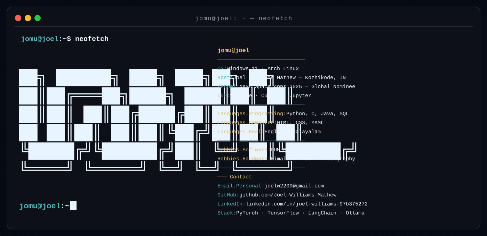

<!--
  VARIANT D ??? "JOMU-TERM / NEOFETCH"
  Terminal-native identity. Independent branch.
-->

<p align="center">
  
</p>

<p align="center">
  <code>jomu@joel:~$ cat /etc/joel</code>
</p>

<p align="center">
  <code>builder | AI &amp; DS @ SJCET ?? ML Intern @ Cognifyz &amp; PaceLab ?? NASA Space Apps 2025 ?? Himalayan 450</code>
</p>

<p align="center">
  
</p>

### INSTALLED PACKAGES

```
$ pacman -Q python c java sql pytorch tensorflow scikit-learn
python ?? c ?? java ?? sql ?? pytorch ?? tensorflow ?? scikit-learn

$ pacman -Q langchain ollama huggingface-hub
langchain ?? ollama ?? huggingface-hub

$ pacman -Q numpy pandas matplotlib
numpy ?? pandas ?? matplotlib

$ pacman -Q react html css javascript
react ?? html ?? css ?? javascript

$ pacman -Q mysql firebase neon
mysql ?? firebase ?? neon

$ pacman -Q git github vscode cursor jupyter
git ?? github ?? vscode ?? cursor ?? jupyter
```

<p align="center">
  
</p>

### RUNNING SERVICES

```
$ systemctl --user status
dum-e.service        active (running)   voice-first desktop automation
gnns.service         active (running)   neuroevolution in Pygame
spaceapps.service    inactive (dead)    NASA Space Apps 2025 ??? GLOBAL NOMINEE
mlpipes.service      active (running)   raw CSV ??? Jupyter ??? recsys
flutter.service      active (running)   UI on real business logic
```

<p align="center">
  
</p>

### GIT LOG --oneline -6

```
$ git log --oneline -6
b59c359 feat: DUM-E ??? voice-first automation core
7k2m31b feat: GNNS ??? neuroevolution goes brrr
9f0a2c4 feat: NASA Space Apps 2025 ??? GLOBAL NOMINEE
b3d18c7 feat: ML pipelines ??? recsys from raw CSV
d4e7a19 feat: Flutter UI on real business logic
```

<p align="center">
  
</p>

### TELEMETRY

<p align="center">
  
</p>

<p align="center">
  <picture>
    <source media="(prefers-color-scheme: dark)" srcset="https://raw.githubusercontent.com/Joel-Williams-Mathew/Joel-Williams-Mathew/output/stats-dark.svg"/>
    <source media="(prefers-color-scheme: light)" srcset="https://raw.githubusercontent.com/Joel-Williams-Mathew/Joel-Williams-Mathew/output/stats-light.svg"/>
    
  </picture>
  <picture>
    <source media="(prefers-color-scheme: dark)" srcset="https://raw.githubusercontent.com/Joel-Williams-Mathew/Joel-Williams-Mathew/output/top-langs-dark.svg"/>
    <source media="(prefers-color-scheme: light)" srcset="https://raw.githubusercontent.com/Joel-Williams-Mathew/Joel-Williams-Mathew/output/top-langs-light.svg"/>
    
  </picture>
</p>


<p align="center">
  <picture>
    <source media="(prefers-color-scheme: dark)" srcset="https://raw.githubusercontent.com/Joel-Williams-Mathew/Joel-Williams-Mathew/output/github-contribution-grid-snake-dark.svg"/>
    <source media="(prefers-color-scheme: light)" srcset="https://raw.githubusercontent.com/Joel-Williams-Mathew/Joel-Williams-Mathew/output/github-contribution-grid-snake.svg"/>
    
  </picture>
</p>

<p align="center">
  
</p>

### OPEN PORTS

```
$ nmap -p- joel.local
PORT    SERVICE
22/tcp  ssh           git access ??? github.com/Joel-Williams-Mathew
443/tcp https         linkedin.com/in/joel-williams-97b375272
443/tcp https         instagram.com/jomu.willy
443/tcp https         x.com/joelw2200
587/tcp smtp          joelw2200@gmail.com
```

<p align="center">
  
</p>

<p align="center"><code>END OF FILE ??? EOF</code></p>
