<!--
  AURORA // EXPEDITION LOG — variant E
  A night-sky observatory identity. Pure SVG, no services, no stale badges.
  Credits: Aurora Veil + Tech Sphere (beydemirfurkan/awesome-github-profile) — CC0, adapted.
-->

  

  <b>THE FIELD LOG OF JOEL WILLIAMS</b> 
  escape velocity from the terminal, into the skyline

  

### 01 — EXPEDITION

<table>
  <tr>
    <td width="58%" valign="top">

I build intelligent systems that leave the lab.

B.Tech Artificial Intelligence &amp; Data Science at
**SJCET, Palai**. ML Intern at **Cognifyz** and
**PaceLab, Kozhikode**. Two-time hackathon finalist.
**NASA Space Apps 2025 — Global Nominee.**

Based out of Kozhikode — where the Western Ghats
meet the Arabian Sea, and the sky still wins.

 

> *"Build it, break it, ship it — then make it cinematic."*

    </td>
    <td valign="top" width="42%">

**MANIFEST**

- **ship** — DUM-E, voice-first desktop automation (PyAutoGUI + TTS)
- **train** — GNNs, neuroevolution inside Pygame
- **file** — NASA Space Apps 2025 — global nominee
- **log** — ML pipelines, CSV → Jupyter → recommendation engines
- **carry** — Royal Enfield Himalayan 450 · cinematic photography
- **note** — Kozhikode, Kerala — where the sky still wins

    </td>
  </tr>
</table>

  

### 02 — ORBITAL TOOLBELT

  

  Radius ≈ tenure. Outer ships. Inner learns. Centre is this week.

  

### 03 — EXPEDITIONS

| No. | Expedition | Cargo | Status |
|:-:|:--|:--|:-:|
| 01 | **DUM-E** | Voice-first Python desktop automation — PyAutoGUI + TTS | `IN DEV` |
| 02 | **GENETIC NEURAL NETWORKS** | Neuroevolution inside Pygame — populations rise or fall on camera | `TRAINING` |
| 03 | **NASA SPACE APPS 2025** | Deadline engineering — finished first, remembered for weeks | `NOMINEE` |
| 04 | **ML PIPELINES** | Raw CSV → Jupyter → custom recommendation logic | `SHIPPING` |
| 05 | **FLUTTER FULL-STACK** | Opinionated UI wired to real business logic | `BUILDING` |

  

### 04 — TRANSMISSION

Open to internships, collaborations and honest engineering conversations.

| Channel | Coordinates |
|:--|:--|
| **GitHub** | [github.com/Joel-Williams-Mathew](https://github.com/Joel-Williams-Mathew) |
| **LinkedIn** | [linkedin.com/in/joel-williams-97b375272](https://www.linkedin.com/in/joel-williams-97b375272/) |
| **Instagram** | [instagram.com/jomu.willy](https://www.instagram.com/jomu.willy/) |
| **X (Twitter)** | [x.com/joelw2200](https://x.com/joelw2200) |
| **Direct line** | [joelw2200@gmail.com](mailto:joelw2200@gmail.com) |

  

### 05 — FIELD DATA

Shipped daily. Honest record, no decorative numbers.

  

  <picture>
    <source media="(prefers-color-scheme: dark)" srcset="https://raw.githubusercontent.com/Joel-Williams-Mathew/Joel-Williams-Mathew/output/stats-dark.svg"/>
    <source media="(prefers-color-scheme: light)" srcset="https://raw.githubusercontent.com/Joel-Williams-Mathew/Joel-Williams-Mathew/output/stats-light.svg"/>
    
  </picture>
  <picture>
    <source media="(prefers-color-scheme: dark)" srcset="https://raw.githubusercontent.com/Joel-Williams-Mathew/Joel-Williams-Mathew/output/top-langs-dark.svg"/>
    <source media="(prefers-color-scheme: light)" srcset="https://raw.githubusercontent.com/Joel-Williams-Mathew/Joel-Williams-Mathew/output/top-langs-light.svg"/>
    
  </picture>

  <picture>
    <source media="(prefers-color-scheme: dark)" srcset="https://raw.githubusercontent.com/Joel-Williams-Mathew/Joel-Williams-Mathew/output/github-contribution-grid-snake-dark.svg"/>
    <source media="(prefers-color-scheme: light)" srcset="https://raw.githubusercontent.com/Joel-Williams-Mathew/Joel-Williams-Mathew/output/github-contribution-grid-snake.svg"/>
    
  </picture>

  

<code>END OF TRANSMISSION — GO BUILD SOMETHING UNDER THE SKY</code>

